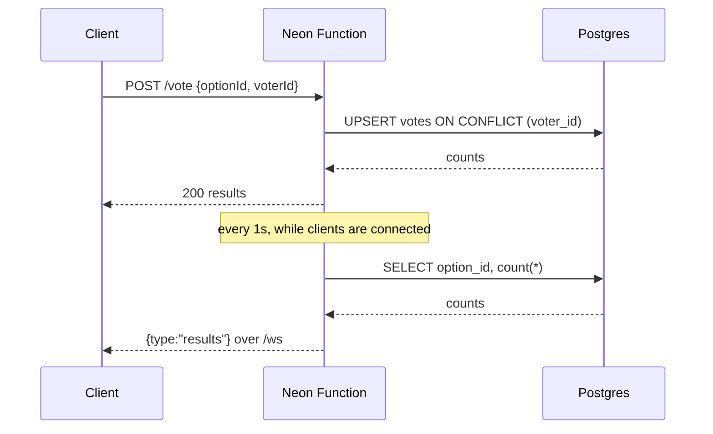

# Live poll over WebSockets

This template is a poll API that runs as a [Neon Function](https://neon.com/docs/compute/functions/overview). Clients vote over HTTP, and the function pushes the results to every connected client over a WebSocket. Votes live in [Lakebase Postgres](https://neon.com/lakebase), so results stay in sync across clients and isolates.

- [`upgradeWebSocket`](https://neon.com/docs/compute/functions/websockets) from `@neon/functions` turns a `GET /ws` request into a live socket.
- [`pg`](https://node-postgres.com) reads and writes the votes through a connection pool that the function registers with `attachDatabasePool`.
- Neon injects `DATABASE_URL` from the linked branch, so there is nothing to configure.

## Scaffold it

Install the latest Neon CLI, then create the function from the registry:

```bash
npm install -g neon@latest
neon login
neon link
neon functions new websocket-live-poll --slug livepoll
```

The CLI writes `functions/livepoll/index.ts`, declares `livepoll` in `neon.ts`, and installs the template's dependencies. `neon link` pulls `DATABASE_URL` into `.env.local`.

## Run locally

```bash
neon dev
```

`neon dev` serves every function declared in `neon.ts` and prints its URL (the default is `http://localhost:8787/`). Connect a WebSocket client, then vote from a second terminal:

```bash
# Terminal 1: prints the current counts, then a frame per change
npx wscat -c ws://localhost:8787/ws

# Terminal 2: vote; use a different voterId for each voter
curl -s -X POST http://localhost:8787/vote \
  -H 'content-type: application/json' \
  -d '{"optionId":"ws","voterId":"test-voter-1"}'
```

The HTTP routes work on their own too. `GET /` prints the route index, `GET /results` returns the counts, and a non-upgrade request to `/ws` returns `426`.

> [!NOTE]
> WebSockets in `neon dev` require Neon CLI 2.45 or newer.

## Routes

<Operations>

| Method | Path | Result |
| --- | --- | --- |
| `GET` | `/` | Plain-text index of the routes |
| `GET` | `/results` | Current counts as JSON |
| `POST` | `/vote` | `{ "optionId": "ws", "voterId": "<random id>" }`; returns the updated counts |
| `GET` | `/ws` | WebSocket upgrade; pushes `{ "type": "results" }` frames and `{ "type": "ping" }` keepalives |

</Operations>

`optionId` must be one of `ws`, `sse`, or `http`, and `voterId` must be 8-64 letters, digits, hyphens, or underscores. Bad input returns `400`, an unknown route returns `404`, and a non-upgrade request to `/ws` returns `426`.

In the diagram below, clients send votes over HTTP and get results back over the socket.



- `votes` has `voter_id` as its primary key, so each voter has one current vote. Voting again updates that row instead of adding another.
- The function creates the table with `CREATE TABLE IF NOT EXISTS` on the first request that needs it, so there is no migration step.
- Each isolate keeps its connected sockets in memory. Every second, while it has clients, it reads the counts from Postgres and pushes them when they change, so isolates don't need to message each other.
- The timer starts with the first client and stops with the last, so an idle isolate can scale to zero. A 25-second `ping` keeps proxies from dropping idle sockets.
- A new client gets the current counts as soon as its socket opens, so it doesn't wait for the next change.

`POST /vote` has no authentication, so add authentication and a verified user identity before you expose writes. Polling Postgres every second is fine for a demo and works with scale-to-zero. For production fan-out across many isolates, use [Neon Realtime](https://neon.com/docs/realtime), or use `LISTEN/NOTIFY` and accept the long-lived connection it needs.

## Deploy

```bash
neon deploy
neon functions get livepoll
```

`neon functions get` prints the function's public URL. Use it as-is for HTTP, and with `wss://` for the socket:

```bash
BASE_URL=https://<function-url>
WS_URL=wss://<function-url>

curl -s "$BASE_URL/results"
npx wscat -c "$WS_URL/ws"
```
