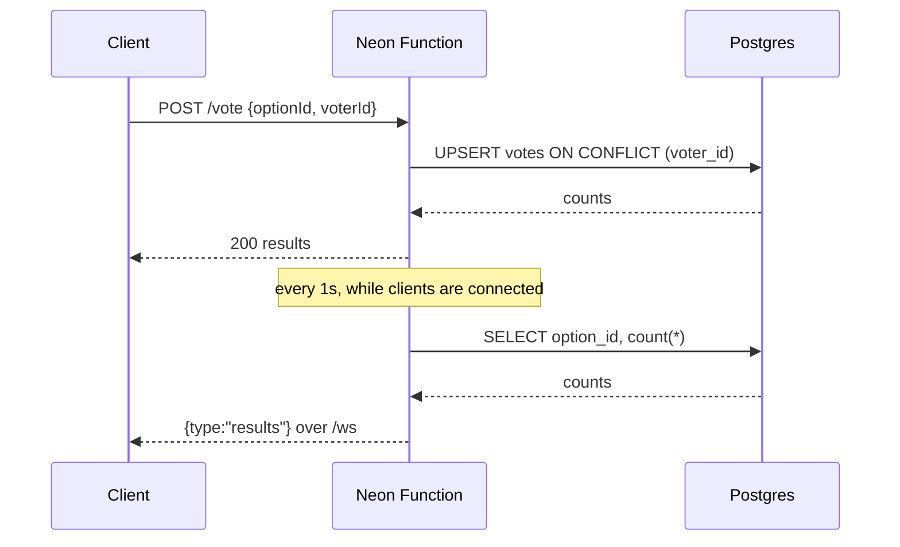

# Live poll over WebSockets

A Neon Function that writes poll votes over HTTP and pushes the results to every connected client over a WebSocket. Votes live in [Lakebase Postgres](https://neon.com/lakebase), so results stay in sync across clients and across isolates.

The function is API-only: it returns JSON, a plain-text route index, and a WebSocket upgrade. Any frontend can call it directly.

- [`upgradeWebSocket`](https://neon.com/docs/compute/functions/websockets) from `@neon/functions` turns the `GET /ws` request into a live socket.
- [`pg`](https://node-postgres.com) reads and writes the votes through a connection pool registered with `attachDatabasePool`.
- [`wscat`](https://github.com/websockets/wscat) is the quickest way to watch the pushed frames.
- `DATABASE_URL` is injected from the linked branch by Neon; there is nothing to configure.

## Scaffold it

Install the latest Neon CLI, then create the function from the registry:

```bash
npm install -g neon@latest
neon login
neon link
neon functions new websocket-live-poll
```

The CLI writes `functions/websocketlivepoll/index.ts`, declares `websocketlivepoll` in `neon.ts`, and installs the template's dependencies. `neon link` pulls `DATABASE_URL` into `.env.local`.

## Run locally

```bash
neon dev
```

`neon dev` serves every function in `neon.ts` and prints its URL (the default is `http://localhost:8787/`). Connect a WebSocket client, then vote from a second terminal to see the pushed frame:

```bash
# Terminal 1: prints the counts on connect, then a frame per change
npx wscat -c ws://localhost:8787/ws

# Terminal 2: vote; use a different voterId for each voter
curl -s -X POST http://localhost:8787/vote \
  -H 'content-type: application/json' \
  -d '{"optionId":"ws","voterId":"test-voter-1"}'
```

The HTTP routes work on their own too: `curl -s http://localhost:8787/` prints the route index, `curl -s http://localhost:8787/results` returns the counts, and `curl -i http://localhost:8787/ws` shows the `426` a non-upgrade request gets.

## Routes

| Route | Purpose |
| --- | --- |
| `GET /` | Plain-text index of the routes, for a quick manual check. |
| `GET /results` | Current counts as JSON. |
| `POST /vote` | `{ "optionId": "ws", "voterId": "<random id>" }`. |
| `GET /ws` | WebSocket upgrade. Pushes `{ "type": "results", ... }` and `{ "type": "ping" }`. A non-upgrade request gets `426`. |

## Deploy

```bash
neon deploy
neon functions get websocketlivepoll
```

`neon functions get` prints the function's public URL. Use it as-is for HTTP, and with `wss://` for the socket:

```bash
BASE_URL=https://<function-url>
WS_URL=wss://<function-url>

curl -s "$BASE_URL/results"
npx wscat -c "$WS_URL/ws"
```

## How it works

Votes are written over HTTP; results stream back over the socket.



- `votes` has `voter_id` as its primary key, so each client has one current vote. Voting again updates that row instead of adding another.
- Each isolate keeps its own connected sockets in memory. Every second, while it has clients, it reads the counts from Postgres and pushes them when they change. No cross-isolate messaging is needed. The timer starts with the first client and stops with the last, so an idle isolate can scale to zero.
- A new client is sent the current counts as soon as its socket opens, so it doesn't wait for the next change.
- The poll options are constants in the module; Postgres stores only the votes.
- The table is created lazily on the first request that needs it (`/results`, `/vote`, or `/ws`), so there is no migration step to run.

## Notes

- `POST /vote` is unauthenticated. This is a demo; add authentication and a verified user identity before exposing writes.
- Polling Postgres every second is right for a demo and works with scale-to-zero. For production fan-out with many isolates, use [Neon Realtime](https://neon.com/docs/realtime), or accept `LISTEN/NOTIFY` and the long-lived connection it needs.
- WebSockets in `neon dev` need Neon CLI 2.45 or newer.
- The function returns JSON and a WebSocket, not HTML. Point a client-only app (a React or TanStack SPA, or a backend job) at it directly, or connect with a WebSocket client.
